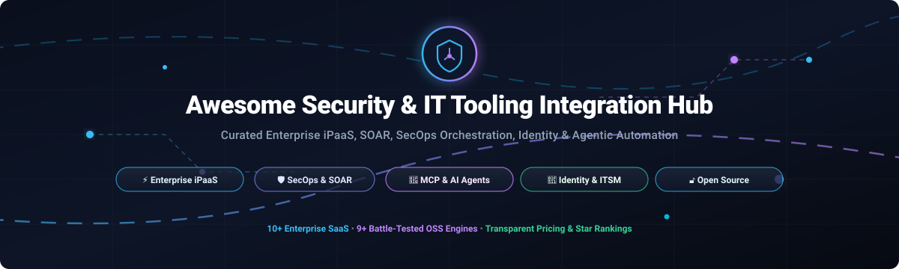

# 🛡️ Awesome-Security-IT-Tooling-Integration-Hub

  

  
  
  
  
  
  
  

# 🚀 Awesome Security & IT Tooling Integration Hub

> 🎯 **A curated directory of top Security and IT Tooling Integration Hub platforms, Enterprise iPaaS solutions, Security Orchestration, Automation and Response (SOAR) engines, and open-source workflow connectors.** Connect SIEM, EDR, ITSM, identity providers (IdP), and autonomous AI agents through governed, automated pipelines.
> 
> 🌟 **Star this repository if you find it helpful!** 🌟

---

## 🔍 Key Search & Topic Tags (SEO)
`integration-hub` • `security-tooling` • `it-operations` • `ipaas` • `workflow-automation` • `soar` • `secops-automation` • `mcp-server` • `model-context-protocol` • `enterprise-integration` • `incident-response` • `threat-intelligence` • `cybersecurity` • `devops-orchestration` • `open-source-automation`

---

## 📋 Table of Contents

- [🌐 Sector Overview & Market Dynamics](#-sector-overview--market-dynamics)
- [🟦 SaaS / Hosted Platforms](#-saas--hosted-platforms)
- [🟩 Open-Source Software](#-open-source-software)
- [📊 Comparison at a Glance](#-comparison-at-a-glance)
- [🤝 Contributing](#-contributing)
- [💖 Support & Sponsorship](#-support--sponsorship)
- [⭐ Star History](#-star-history)
- [📄 License](#-license)

---

## 🌐 Sector Overview & Market Dynamics

The global **Integration Platform as a Service (iPaaS)** and enterprise workflow automation market was valued at **$8.5B to $11B in 2024–2025** and is projected to surpass **$18B by 2026–2030**, advancing at a robust Compound Annual Growth Rate (CAGR) of **23% to 26%**. 

The sector features a **moderately fragmented yet top-heavy competitive dynamic**:
- 🏢 **Enterprise Leaders**: Cloud titans and established integration suites (Microsoft, Salesforce/MuleSoft, Boomi) control multi-million-dollar core infrastructure contracts.
- 🔀 **Multi-Tool Fragmentation**: Over 70% of enterprises deploy 2 or more integration tools concurrently across SecOps, Cloud Infrastructure, and Business Operations.
- 🤖 **Agentic & AI Disruption**: High demand for **Model Context Protocol (MCP)** tool connectors and agentic AI governance has opened hyper-growth avenues for agile challengers (Workato, Zapier Central, Make) and self-hosted open-source orchestration engines.

---

## 🟦 SaaS / Hosted Platforms

Commercial, cloud-hosted Security and IT Tooling Integration Hub platforms. Sorted in descending order by company scale (market capitalization / enterprise valuation / ARR).

| Platform | 🏢 Company Scale (Valuation / Revenue) | 💳 Starting Pricing (Paid) | 🎁 Free Tier / Trial Limits | 🛡️ Key Capabilities & Security Focus |
|---|---|---|---|---|
| **[Microsoft Power Automate](https://powerautomate.microsoft.com/)** | ~$3.1T Market Cap (~$245B+ ARR) | $15/user/month (Power Automate Premium) | **90-day free trial** (Premium features, 40,000 requests/day ceiling) or basic inclusion in M365 (standard connectors only, 6,000 actions/day) | Enterprise low-code workflow automation, 1,000+ connectors, Microsoft Sentinel & Defender integration, desktop RPA, Dataverse support |
| **[MuleSoft Anypoint Platform](https://www.mulesoft.com/)** | ~$300B Market Cap (Salesforce; MuleSoft acq. $6.5B; $1.5B+ ARR) | ~$2,000/month (~$24,000/year base commitment) | **30-day free trial** (Anypoint Platform evaluation environment, API Designer, and test runtime) | Full-lifecycle API management and enterprise iPaaS, certified connector exchange, AI Connectors for MCP & agent-to-agent architectures |
| **[Make](https://www.make.com/)** | $13B Valuation (Celonis parent; acq. Integromat) | $9/month billed annually ($10.59/mo billed monthly; Core plan) | **Free forever plan**: 1,000 operations/month, 2 active scenarios, 15-min interval, 5 MB file size limit | Visual automation canvas, 3,000+ connectors, native MCP server for LLMs, process mining & execution management |
| **[Workato](https://www.workato.com/)** | $5.7B Valuation (~$150M+ ARR) | $75/month (Self-service starter credit packs) or ~$25,000–$60,000+/year for Enterprise packages | **Free forever tier**: One-time grant of 50,000 credits to test workflows and recipes with community connectors | Enterprise iPaaS with 1,200+ connectors, native MCP server packaging for AI agents, SOC 2 Type II, ISO 27001/42001, HIPAA, and DORA compliance |
| **[Zapier](https://zapier.com/)** | $5.0B Valuation (~$310M+ ARR) | $19.99/month billed annually ($29.99/mo billed monthly; Professional plan) | **Free forever plan**: 100 tasks/month, unlimited two-step Zaps (1 trigger + 1 action), 15-minute polling interval | 7,000+ app integrations, AI Guardrails (PII & prompt-injection detection), multi-step logic, audit logging, role-based controls |
| **[Boomi Connect](https://boomi.com/)** | $4.0B Valuation (~$500M+ ARR) | $99/month (Pay-As-You-Go entry tier) or ~$20,000–$50,000+/year (Enterprise base) | **30-day free trial**: Access to Boomi Enterprise Platform integration runtime, low-code mapper, and baseline API management | 1,000+ managed enterprise tools exposed to AI assistants via MCP, full OAuth pass-through, CISO-ready audit logging & observability |
| **[Druva Marketplace](https://www.druva.com/)** | $2.0B+ Valuation (~$200M+ ARR) | ~$4.00 to $8.00/user/month (SaaS workloads) or post-dedupe consumption storage tiers | **30-day free trial**: Full access to cloud backup connectors, guided onboarding checklists, and live chat support | Data protection-native integration hub bridging Druva Data Security Cloud with SIEM (Splunk, Sentinel), IAM (Okta, Entra ID), and ITSM (ServiceNow) |
| **[SnapLogic](https://www.snaplogic.com/)** | $1.0B Valuation (~$100M+ ARR) | ~$9,995/year (Developer/entry package) | **Proof-of-Concept (PoC) trial**: 14 to 30 days available upon enterprise sales qualification (no open self-service free tier) | Cloud-native iPaaS with 1,000+ Snaps, unlimited data ingestion volume, AI agent integration via MCP, embedded OEM program |
| **[Jitterbit Harmony](https://www.jitterbit.com/)** | ~$95M–$150M PE valuation (~$105M ARR; Audax PE) | ~$1,000/month (~$12,000/year billed annually; Standard plan) | **14-day free trial**: Access to Harmony platform Studio, test private agent, and basic cloud connectors | Unified iPaaS, API Manager, and EDI platform; ISO 42001 certified for responsible AI; governed MCP agent tool exposure |
| **[Celigo](https://www.celigo.com/)** | ~$72M–$85M Funding (~$90M+ ARR) | ~$500 to $600/month (~$12,800/year billed annually; Standard plan) | **30-day free trial** (unlimited endpoints & flows), downgrading to **Free plan**: 2 endpoints and 1 active flow | Mid-market and enterprise iPaaS with 1,000+ pre-built connectors, on-premises agent support, Ora AI automation builder |

---

## 🟩 Open-Source Software

Self-hosted, community-driven Security and IT Tooling Integration tools, frameworks, and SOAR orchestration engines. Sorted in descending order by GitHub stargazers count.

### 🌟 [n8n](https://github.com/n8n-io/n8n) 
- **💻 Stack:** TypeScript / Node.js | **⚖️ License:** Sustainable Use (source-available)
- **📖 Overview:** n8n is the most popular self-hostable workflow automation platform featuring a visual node-based editor, 400+ built-in app nodes, and native JavaScript/Python execution nodes.
- **🛡️ Security & IT Fit:** Widely adopted by SOC and SecOps teams for threat intelligence feeds, IOC enrichment (VirusTotal, AlienVault), automated phishing triage, and SIEM-to-Slack alerting workflows.

### 🌟 [Activepieces](https://github.com/activepieces/activepieces) 
- **💻 Stack:** TypeScript / Node.js | **⚖️ License:** MIT / Commercial (Fair-code)
- **📖 Overview:** An open-source, no-code workflow automation engine designed as an extensible, developer-friendly alternative to Zapier and Make.
- **🛡️ Security & IT Fit:** Features 300+ community pieces (including Slack, Discord, GitHub, AWS, Webhooks), granular role-based access control, AI agent tool execution, and an MIT-licensed core perfect for on-prem automation.

### 🌟 [OpenCTI](https://github.com/OpenCTI-Platform/opencti) 
- **💻 Stack:** TypeScript / GraphQL / Python | **⚖️ License:** Apache-2.0
- **📖 Overview:** An open-source Cyber Threat Intelligence (CTI) integration hub and knowledge management platform adhering strictly to STIX 2.1 standards.
- **🛡️ Security & IT Fit:** Serves as a central routing hub connecting threat telemetry with EDRs, SIEMs (Splunk, Elastic, Sentinel), firewall blocklists, and MISP through 150+ official and community connectors.

### 🌟 [StackStorm](https://github.com/StackStorm/st2) 
- **💻 Stack:** Python | **⚖️ License:** Apache-2.0 (Linux Foundation)
- **📖 Overview:** Robust event-driven DevOps and IT operations automation platform ("IFTTT for Ops") that ties together enterprise security sensors and remediation actions.
- **🛡️ Security & IT Fit:** Employs rule-based triggers and auto-remediation packs for incident response (PagerDuty, ServiceNow, Nagios, AWS, Kubernetes), auto-healing IT infrastructure, and executing auditable SOC playbooks.

### 🌟 [Apache Camel](https://github.com/apache/camel) 
- **💻 Stack:** Java / YAML / XML | **⚖️ License:** Apache-2.0
- **📖 Overview:** Enterprise integration framework implementing Enterprise Integration Patterns (EIP) with 350+ modular components and connectors.
- **🛡️ Security & IT Fit:** Battle-tested enterprise runtime with deep security primitives including Apache Shiro route policies, XML/Crypto payload encryption, TLS/mTLS endpoint security, and Jasypt credential masking.

### 🌟 [Shuffle](https://github.com/Shuffle/Shuffle) 
- **💻 Stack:** Python / Go | **⚖️ License:** AGPL-3.0 / Apache-2.0
- **📖 Overview:** Open-source Security Orchestration, Automation, and Response (SOAR) platform built specifically by and for cybersecurity professionals.
- **🛡️ Security & IT Fit:** Provides OpenAPI-driven app generation, real-time SOC incident workflows, sub-flow nesting, EDR containment actions (CrowdStrike, Defender), and hybrid cloud-to-onprem execution nodes.

### 🌟 [WSO2 Micro Integrator](https://github.com/wso2/product-integrator-mi) 
- **💻 Stack:** Java | **⚖️ License:** Apache-2.0
- **📖 Overview:** Cloud-native, high-throughput integration runtime and ESB alternative designed for containerized environments and microservice meshes.
- **🛡️ Security & IT Fit:** Offers pre-built connectors for LDAP/Active Directory, ServiceNow, Salesforce, and database endpoints, with native Prometheus observability, mTLS, and inbound MCP support.

### 🌟 [Prismatic Components Library](https://github.com/prismatic-io/components) 
- **💻 Stack:** TypeScript | **⚖️ License:** Apache-2.0
- **📖 Overview:** Production reference repository containing Prismatic's catalog of application and data platform connectors.
- **🛡️ Security & IT Fit:** Clean, TypeScript-based connector implementations for SaaS, databases, and APIs; useful as an extensible foundation or reference implementation for custom IT connectors.

### 🌟 [ConnectKit](https://github.com/open-assistants-lab/ConnectKit) 
- **💻 Stack:** Python | **⚖️ License:** Apache-2.0
- **📖 Overview:** On-device SaaS connectivity library providing AI agents and local tools access to 520+ service APIs via declarative YAML specs and local SQLite vaults.
- **🛡️ Security & IT Fit:** Zero-cloud external dependency; encrypts authentication tokens locally, supporting MCP adapters for local SecOps or IT diagnostic assistant agents.

---

## 📊 Comparison at a Glance

| Software | ⚖️ License | 🚚 Delivery Model | 🔌 Primary Connector Count | 🛡️ Security Focus | 🤖 MCP / AI Agent Ready | 💻 Self-Hosted | 🎯 Target Fit |
|---|---|---|---|---|---|---|---|
| **Microsoft Power Automate** | Proprietary | Cloud | 1,000+ | Sentinel / Defender / Entra | ✅ Copilot & Actions | ❌ | Microsoft-centric enterprise ecosystems |
| **MuleSoft Anypoint** | Proprietary | Cloud | Hundreds certified | GovCloud / ISO / SOC | ✅ AI Connectors | ❌ | Large enterprise governed iPaaS |
| **Make** | Proprietary | Cloud | 3,000+ | Process spend / RBAC | ✅ Native MCP Server | ❌ | Visual automation & Celonis process mining |
| **Workato** | Proprietary | Cloud | 1,200+ | SOC 2 / ISO 42001 / HIPAA | ✅ Governed MCP Packages | ❌ | High-governance enterprise iPaaS |
| **Zapier** | Proprietary | Cloud | 7,000+ | AI Guardrails / SOC 2 | ✅ Zapier Central / MCP | ❌ | Broad application connectivity |
| **Boomi Connect** | Proprietary | Cloud | 1,000+ | CISO Audit / Zero-Trust | ✅ MCP-Native | ❌ | Governed AI access to IT tools |
| **Druva Marketplace** | Proprietary | Cloud | Dedicated Suite | SIEM / IdP / ITSM | (API / Webhooks) | ❌ | Data protection & backup ecosystem hub |
| **SnapLogic** | Proprietary | Cloud | 1,000+ Snaps | SOC 3 / SAML SSO | ✅ AgentCreator / MCP | ❌ | High-volume pipelines & OEM embedding |
| **Jitterbit Harmony** | Proprietary | Cloud | 1,000+ (EDI/APIs) | ISO 42001 / NIST | ✅ Harmony AI / MCP | ❌ | Unified iPaaS, API management & EDI |
| **Celigo** | Proprietary | Cloud / Hybrid | 1,000+ | MFA / RBAC / Sandboxes | (Ora AI Assistant) | ❌ | ERP/business system automation |
| **n8n** | Sustainable Use | Self-Hosted / Cloud | 400+ | Community SOC Workflows | ✅ LangChain / Custom | ✅ | Self-hosted SecOps & IT automation |
| **Activepieces** | MIT / Fair-code | Self-Hosted / Cloud | 300+ | RBAC / On-prem isolation | ✅ AI Action Pieces | ✅ | Open-source Zapier alternative |
| **OpenCTI** | Apache-2.0 | Self-Hosted / Cloud | 150+ Connectors | STIX 2.1 Threat Intel Hub | ✅ AI Summaries & Feeds | ✅ | Central cyber threat intelligence hub |
| **StackStorm** | Apache-2.0 | Self-Hosted | 180+ Packs | Auto-remediation & Audits | (Event Triggers) | ✅ | Event-driven IT operations & DevOps |
| **Apache Camel** | Apache-2.0 | Self-Hosted | 350+ Components | Built-in Crypto & Shiro | (Custom Camel Routes) | ✅ | Enterprise code-first secure integration |
| **Shuffle** | AGPL-3.0 / Apache | Self-Hosted / Cloud | OpenAPI-driven | Dedicated SOAR Hub | ✅ AI SOC Workflows | ✅ | Open-source SOAR for SOC teams |
| **WSO2 MI** | Apache-2.0 | Self-Hosted / Cloud | Enterprise Library | LDAP / mTLS / IAM | ✅ Inbound MCP | ✅ | Microservices & open-source MuleSoft alternative |
| **Prismatic** | Apache-2.0 | Reference / Cloud | Core Library | Clean TypeScript specs | (AI-assisted scaffolding) | ✅ (Fork) | Connector architecture reference code |
| **ConnectKit** | Apache-2.0 | Self-Hosted | 520+ YAML Specs | Local SQLite credential vault | ✅ Native MCP Adapters | ✅ | On-device AI agent SaaS connectivity |

---

## 🤝 Contributing

Contributions are warmly welcome! 🎉 If you would like to submit an open-source Security or IT Tooling Integration Hub, SOAR platform, or custom connector framework, please feel free to open a Pull Request:

1. 🍴 Fork the repository.
2. 🌿 Create your feature branch (`git checkout -b feature/awesome-tool`).
3. 📝 Add your tool with project name, repository link, tech stack, license, and why it stands out.
4. 🚀 Push to the branch (`git push origin feature/awesome-tool`).
5. 📬 Open a Pull Request!

---

## 💖 Support & Sponsorship

If this project has saved you time, streamlined your SecOps architecture, or helped you evaluate integration platforms, please consider showing your support:

- ⭐ **Star this repository** on GitHub!
- 🍴 **Fork and share** it with fellow security engineers, DevOps specialists, and IT leads.
- ☕ **Buy me a coffee & support ongoing maintenance:** Visit the [GitHub Sponsors Dashboard](https://github.com/sponsors/ishandutta2007) to sponsor!

Your encouragement and sponsorship help keep this directory accurate, up-to-date, and growing! 🙌

---

## ⭐ Star History

---

## 📄 License

This repository is released under the [Creative Commons Zero v1.0 Universal](LICENSE) (Public Domain / CC0-1.0). All referenced trademarks, service marks, logos, and product names are the property of their respective owners.

---

  <b>⭐ If this list helped you discover a useful integration platform, please star the repo! ⭐</b>

